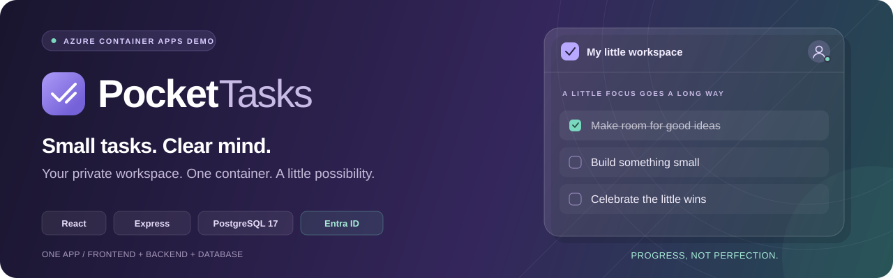

# Pocket Tasks



A small, full-stack todo demo for **one Azure Container App running one container**:


The **Container Apps environment** hosts the app; **Azure Container Registry** stores its image. A **user-assigned managed identity** has registry-scoped `AcrPull`, while **Microsoft Entra ID** handles user sign-in. Express serves the React build and API on the same origin; PostgreSQL remains private inside the container, with no separate managed database.

## What's included

- Add, edit, complete, reopen, delete, filter and search your own tasks.
- Top-right avatar with initials, a signed-in indicator, Profile, Settings and Logout.
- Light/dark mode saved to your account, with a browser preference for the signed-out page.
- Single-tenant Microsoft Entra sign-in using MSAL, authorization code + PKCE, state and nonce checks.
- Server-side PostgreSQL sessions, HTTP-only cookies, CSRF protection, input validation and rate limiting.
- One non-root image, startup/readiness/liveness checks, Bicep deployment templates and CI.

**This is deliberately not a production database architecture.** Data, accounts, preferences and sessions live in the container's writable filesystem. They may survive a process restart, but are lost when the container/replica is replaced, rescheduled or redeployed. There are no backups. Keep `minReplicas: 1`, `maxReplicas: 1`, and single revision mode. Revision transitions can still briefly run old and new replicas with separate databases; never use this design for durable or shared data. Use an external managed PostgreSQL database for a production version.

## 1. Register Microsoft sign-in (manual/local setup)

For a complete Azure deployment, use **Deploy to Azure Container Apps** below instead: the deployment script creates the registration, enterprise application, credential and redirect URIs automatically. These portal steps are only needed when setting up local development yourself or when your tenant blocks automated registration.

In **Microsoft Entra ID > App registrations > New registration**:

1. Name it `Pocket Tasks demo` and choose **Accounts in this organizational directory only**.
2. Add a **Web** redirect URI: `http://localhost:8080/auth/callback`.
3. Under Authentication, also add `http://localhost:8080/` as a Web redirect URI for the post-logout return.
4. Under Certificates & secrets, create a client secret and keep its **value**, not its secret ID.
5. Record the Directory (tenant) ID and Application (client) ID.

No implicit grant, SPA redirect, Microsoft Graph permissions or local user passwords are needed. The application requests OIDC `openid`, `profile` and `email`; MSAL also adds its standard `offline_access` scope. MSAL's token cache is not persisted; the application retains the verified identity and its own database session, not access/refresh tokens. Tenant policies may require administrator consent or enterprise-app user assignment. Profile names/initials come from the signed-in identity; no Graph photo permission is requested.

After Azure deployment, add the emitted `callbackUrl` and `appUrl` (root URL) as additional **Web** redirect URIs. Use the exact HTTPS hostname; `APP_URL` must match it. If you change to a custom domain, update both `APP_URL` and the registration.

Never commit a client secret or `.env`. Rotate the secret before it expires. Azure runtime secrets are supplied to the Container App, not baked into the image.

## 2. Run the complete container locally

Requires Docker Desktop running Linux containers. Commands below use PowerShell.

```powershell
Copy-Item .env.example .env
# Edit .env with your tenant ID, client ID and client secret value.
# Generate SESSION_SECRET and put the result in .env:
node -e "console.log(require('node:crypto').randomBytes(48).toString('hex'))"

docker build -t pocket-tasks:demo .
docker run --rm --name pocket-tasks -p 127.0.0.1:8080:8080 --env-file .env pocket-tasks:demo
```

Open **http://localhost:8080**. Select **Sign in with Microsoft**, or use the avatar menu. Only port 8080 is published. The entrypoint creates a private database automatically and overrides `DATABASE_URL` inside the container. No second container, external database or volume is required.

For a local HTTP run, `.env` must keep `NODE_ENV=development` and `APP_URL=http://localhost:8080`. In Azure, use `NODE_ENV=production` and an HTTPS `APP_URL`; session cookies are then Secure. Missing/invalid identity or session configuration fails startup explicitly rather than enabling fake authentication.

Stop cleanly from another terminal:

```powershell
docker stop pocket-tasks
```

## Native development

Requires Node.js 24 and an accessible PostgreSQL database. Set `DATABASE_URL` in `.env` for that development database; application tables are created automatically. Use a dedicated database, not a shared production instance.

```powershell
npm ci
npm run build
npm run dev
```

This serves the built UI and API together on port 8080. Rebuild after frontend changes. For Vite hot reload instead, run `npm run dev:ui` in a second terminal, set `APP_URL=http://localhost:5173` in the API's `.env`, and register `http://localhost:5173/auth/callback` plus `http://localhost:5173/` as Web redirect URIs. Browse port 5173; Vite proxies `/api` and `/auth` to the backend.

## Deploy to Azure Container Apps

The demo created from this workspace is available at **https://pocket-tasks.happyisland-c1675f2a.swedencentral.azurecontainerapps.io**, in resource group `rg-pocket-tasks-demo` in Sweden Central. Use an account in the configured Entra tenant (recorded in `.azure/demo-deployment.json`); this single-tenant registration does not accept arbitrary work accounts or personal Microsoft accounts.

The deployment command provisions **billable resources**: a Basic Azure Container Registry, a Container Apps Consumption environment, a user-assigned image-pull identity and one always-running Container App (0.5 vCPU / 1 GiB). It also creates a single-tenant Entra application registration and enterprise application. PostgreSQL remains inside the one application container; there is no separate database service.

### Prerequisites and permissions

- PowerShell **7.2+** (`pwsh`), Azure CLI with Bicep, and Docker Desktop in Linux-container mode.
- Azure resource creation and image push permissions in your selected subscription, plus permission to create role assignments (for example Owner, or Contributor plus Role Based Access Control Administrator at the relevant scope).
- Entra permission to register applications and create service principals/credentials in the subscription's tenant. Azure subscription ownership alone does **not** grant these directory permissions.
- If required by tenant policy, an administrator must approve the enterprise application or assign users before they can sign in.

The script never performs an interactive sign-in for you. Authenticate explicitly first, then select the subscription through its required argument; it does not change your Azure CLI default subscription.

```powershell
az login
# If Bicep is not installed:
az bicep install

pwsh -NoProfile -File .\scripts\Deploy-Demo.ps1 `
  -Subscription "<your-subscription-id-or-exact-name>" `
  -Location "swedencentral"
```

Optional parameters: `-ResourceGroup`, `-AppName`, and `-RegistryName`. Defaults are `rg-pocket-tasks-demo`, `pocket-tasks`, and a deterministic globally unique registry name derived from the subscription/resource group.

### What the command does

1. Verifies the explicit subscription context, registers required resource providers and compiles both Bicep templates.
2. Creates the dedicated resource group, runs ARM what-if, and deploys `infra/platform.bicep` (registry, environment, identity and `AcrPull`). A preview containing resource deletion stops the script.
3. Builds a Linux/amd64 image locally, authenticates Docker to your registry and pushes a new timestamped tag. No ACR build-task entitlement or registry admin password is required.
4. Creates/reuses the deployment's Entra app and service principal, preserving existing Web redirect URIs. It registers localhost and Azure callback/root URLs, without requesting Graph API permissions or enabling implicit grant.
5. Adds a six-month client credential, generates a random session secret, and supplies both through process environment variables to Bicep secure parameters. Neither secret is printed or written to deployment state.
6. Runs what-if and deploys `infra/main.bicep` with HTTPS, one replica and health probes; verifies the live readiness endpoint.

The script records **non-secret** resource names, client/object IDs, credential key ID/expiry, image tag and app URL in ignored `.azure/demo-deployment.json`. Keep this file to resume/redeploy without creating another Entra registration. Do not copy one deployment's state onto a different target. The application image excludes `.azure` and `.env` files.

### Manual step after deployment

Open the emitted HTTPS URL and choose **Sign in with Microsoft**. Complete your organization's normal sign-in/MFA/consent prompts. Verify your avatar, add a task, open Profile, toggle dark mode in Settings, and log out. Automated checks cannot complete MFA or override tenant consent/user-assignment policies.

If you see **admin approval required**, have an Entra administrator review the enterprise application. If assignment is required, assign the intended demo users/groups. The script does not weaken tenant security policies.

### If automated Entra registration is blocked

An authorized administrator can follow the manual registration section above and make you an owner of that app. Then rerun with its **application object ID** (not the client ID):

```powershell
pwsh -NoProfile -File .\scripts\Deploy-Demo.ps1 `
  -Subscription "<your-subscription-id>" -Location "swedencentral" `
  -EntraAppObjectId "<application-object-id>" -SkipImageBuild
```

`-SkipImageBuild` requires a previously pushed image recorded by this deployment; omit it on the first run. You still need permission to update redirect URIs, create a credential and create the corresponding service principal. Otherwise the administrator must perform those directory actions; the script reports the failure rather than bypassing it. A failed deployment does not automatically delete resources and may leave billable infrastructure.

### Redeployments, credentials and data

Rerun the same command from the same checkout/state to build and deploy a new image. For an infrastructure/auth retry after a successful push, add `-SkipImageBuild`. Use the same explicit subscription/region/resource names. A new app credential and session secret are generated on each application deployment attempt. Existing credentials are **not revoked** automatically; after a successful deployment, review `pocket-demo-*` credentials in the Entra portal and manually remove superseded/unused ones only after confirming they are not in use. The current credential's expiry is recorded in deployment state and printed without its value.

Rotate before expiry by redeploying. For local development against the same app registration, create a separate local-development credential in the portal and use it in your ignored `.env`; the Azure credential is deliberately not exported to disk.

Keep one active replica and single revision mode. Expect demo data and sessions to reset on redeployment; this template deliberately provides no persistent storage. For a production version, separate PostgreSQL from the application and add durable storage/backups.

The script does not delete anything on failure or cleanup. Deleting the resource group is a separate, destructive manual action; the Entra registration is tenant-scoped and is **not** removed by deleting that resource group.

## Request logs and frontend-to-database flow

Application logs are newline-delimited JSON on stdout, visible in Docker logs and the Azure Container App's **Monitoring > Log stream**. Every HTTP request reaching Express is logged, including frontend HTML/assets, authentication redirects, API calls, health probes, invalid JSON, failures, 404s and aborted responses. Each response includes `X-Request-ID`.

Frontend API calls generate a UUID and send `X-Request-ID` and a fixed `X-Client-Action` label such as `todos.create`. The browser console records `frontend.request.started` and `frontend.request.completed`/`failed`. The server carries that ID through asynchronous request processing and PostgreSQL/session-store operations, so concurrent requests do not mix together.

A task creation produces this sequence in the **container** log, with the same `requestId`:

```text
frontend.request.received     clientAction=todos.create
http.request.started         method=POST path=/api/todos
db.operation.started         operation=sessions.read
db.operation.completed       operation=sessions.read durationMs=...
db.operation.started         operation=users.read
db.operation.completed       operation=users.read rowCount=1 durationMs=...
db.operation.started         operation=todos.create
db.operation.completed       operation=todos.create rowCount=1 durationMs=...
db.operation.started         operation=sessions.touch
db.operation.completed       operation=sessions.touch durationMs=...
http.request.completed       status=201 durationMs=...
```

Each database operation also has its own `spanId` connecting its start and completion/failure. These are application-observed database calls, not PostgreSQL SQL-statement dumps. A failed database operation emits `db.operation.failed` with an error type and safe database/connection error code, then the HTTP completion records the resulting status.

`frontend.request.received` means the backend received a matching, allow-listed client-action header; it is not proof of browser rendering or trusted audit identity. Browser-side completion/failure events remain in the browser console. UI-only changes such as opening the avatar menu or filtering already-loaded tasks do not make a database request. Each navigation/redirect gets its own request ID.

**No request/response bodies, query strings, SQL text/parameters, task titles, user profiles, cookies, session IDs, CSRF tokens, auth codes or access/refresh tokens are intentionally logged.** Raw exception messages/stacks are excluded from request/database log events because they can contain data. Native PostgreSQL operational logs remain separate; statement/parameter dumps and verbose failing-row details are disabled in the container entrypoint.

Follow the deployed application stream:

```powershell
az containerapp logs show `
  --subscription "<your-subscription-id>" `
  --resource-group rg-pocket-tasks-demo --name pocket-tasks `
  --type console --tail 100 --follow --format text
```

Or locally:

```powershell
docker logs --tail 100 --follow pocket-tasks
```

To correlate an API request, open browser developer tools, inspect the Network response's `X-Request-ID`, and search for that UUID in the container stream and browser console. Health probes are logged too; filter by `path` or `clientAction` when investigating user actions. This setup is a live console stream, not a durable Application Insights/Log Analytics trace store, and verbose request logging can increase log volume.

## Checks

```powershell
npm run typecheck
npm test
npx playwright install chromium
npm run test:e2e
docker build -t pocket-tasks:demo .
az bicep build --file .\infra\main.bicep --stdout
az bicep build --file .\infra\platform.bicep --stdout
```

API and browser tests use an in-memory PostgreSQL emulator by default. To exercise both suites against real PostgreSQL, including the production PostgreSQL session store:

```powershell
$env:TEST_DATABASE_URL = "postgresql://<user>:<password>@localhost:5432/pocket_test"
npm test
npm run test:e2e
Remove-Item Env:\TEST_DATABASE_URL
```

**Use a disposable test database: this mode truncates `users`, `todos` and `sessions`. Do not run the suites concurrently against the same database.** CI runs both against a temporary PostgreSQL 17 instance. Browser tests cover signed-out/signed-in views, repeated task creation beyond two tasks, task CRUD, filters, profile, persisted theme, logout and error states on desktop and mobile. Their identity provider is test-only and is excluded from the production build/image; real Microsoft sign-in requires your own tenant configuration and interactive verification.

Endpoints: `/health/live` checks the HTTP process; `/health/ready` checks PostgreSQL connectivity. PostgreSQL binds only a private Unix socket. The entrypoint stops the whole container if either required process exits, and handles SIGTERM by draining HTTP before stopping PostgreSQL.

## Troubleshooting

- **Container exits immediately:** inspect `docker logs pocket-tasks`; configuration names, not secret values, are reported.
- **AADSTS50011 / redirect mismatch:** check that `APP_URL` and the Web callback URI match exactly, including scheme and port.
- **Sign-in state expired:** use the same hostname throughout (not a mix of `localhost` and `127.0.0.1`), allow cookies, and start sign-in again. A replaced container also loses login state.
- **403 on save/logout:** reload to refresh the CSRF token and check that the browser origin equals `APP_URL`.
- **Add task disabled after a save:** the field clears after a successful save. Enter another non-whitespace title to enable the button again.
- **401 / suddenly signed out:** the session expired (eight hours) or the demo container/database was replaced.
- **Empty tasks after a deployment:** expected for this disposable embedded database.
- **Azure image pull denied:** check the registry permission mode and the managed identity's `AcrPull` assignment.
- **Directory/Graph permission denied:** ask an Entra administrator for application-registration/ownership permissions; Azure RBAC alone is insufficient. Existing Azure resources are left intact.
- **Deployment state belongs to another target:** use the original arguments, or deliberately move `.azure/demo-deployment.json` before provisioning a separate deployment. Moving it can cause a new Entra registration to be created.
- **Client credential expired:** redeploy to inject a new credential, then manually retire superseded credentials after confirming the new deployment works.
- **AADSTS50020 / account not in tenant:** sign in with an account belonging to the configured tenant, or have its administrator approve/invite the intended guest account. The application intentionally does not allow arbitrary tenants.